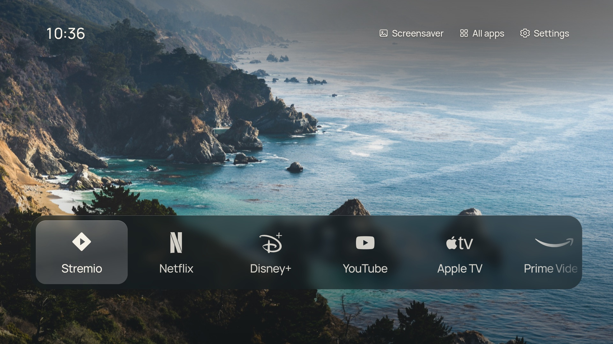

# CleanFrame for Android TV

A quieter home screen for Android TV: your apps, a photograph and the time, made for the TV remote.

This is an Android TV port of [CleanFrame](https://github.com/nthnclrk/CleanFrame) by Nathan Clark, which was built for Samsung The Frame on Tizen. The interface is CleanFrame's own. This repo adds a small Android launcher that runs it, connects it to your installed apps, and can replace your TV's home screen.



## The easy way: give this repo to an AI agent

The best way to set this up is to point a coding agent, such as [Claude Code](https://claude.com/claude-code), at this repo and let it do the work. Setup means installing build tools, finding your TV on the network, connecting over ADB and checking the result on screen. That's all fiddly by hand but routine for an agent running on your computer. Every TV is a little different, and an agent can work out what yours needs as it goes.

Open a terminal, clone the repo, start your agent in it, and paste:

```text
Read AGENTS.md. Build CleanFrame for Android TV and install it on my TV,
which is on the same Wi-Fi network as this computer. Find the TV, walk me
through enabling network debugging if needed, install the APK and show me
a screenshot. Ask me before making CleanFrame my default Home screen or
disabling anything on the TV.
```

The agent needs to run on your own computer (Claude Code, for example) so it can reach your TV. A chat in a browser can't.

[`AGENTS.md`](AGENTS.md) gives the agent the project layout, the safe order of steps, and the rules: always ask before changing the TV, disable rather than uninstall, and keep a way to undo every change.

## What you get

- CleanFrame's List and Dock layouts, wallpapers, typography and glass focus, unchanged.
- **All apps** shows everything installed on the TV, with real icons. You can pick and reorder the apps on Home.
- **Screensaver** starts the Android TV screensaver (CleanFrame's Art Mode button).
- **Android TV Home** and **TV settings** open the system screens.
- Works with the remote: D-pad, OK and Back.
- Can be set as the default Home, so the Home button and power-on go straight to CleanFrame.

## Do it yourself

### 1. Build

You need JDK 17, the Android SDK (platform 35) and `adb`. On macOS:

```sh
brew install openjdk@17 android-platform-tools
brew install --cask android-commandlinetools
sdkmanager "platforms;android-35" "build-tools;34.0.0"
```

Then:

```sh
scripts/sync-ui.sh                       # fetch and patch the CleanFrame UI
cd android && ./gradlew assembleRelease  # -> app/build/outputs/apk/release/app-release.apk
```

Or download a ready-made APK from [Releases](../../releases).

### 2. Turn on network debugging on the TV

1. **Settings → Device Preferences → About**: select **Build** 7 times.
2. **Settings → Device Preferences → Developer options**: turn on **USB debugging**, and **Network debugging** if it's there.
   On Google TV with Android 11 or later, use **Wireless debugging → Pair device with pairing code**, then run `adb pair <ip>:<port> <code>`.
3. Find the TV's IP address under **Settings → Network**.

### 3. Install

```sh
scripts/install.sh <tv-ip>
```

Accept the "Allow debugging?" prompt on the TV the first time.

### 4. Make it your Home screen (optional)

```sh
scripts/set-home.sh <tv-ip>                    # make CleanFrame the default Home
scripts/set-home.sh <tv-ip> --disable-others   # also disable other launchers, so CleanFrame is the only one
scripts/set-home.sh <tv-ip> --restore          # undo --disable-others
```

On plain Android TV, the first command is usually enough. On **Google TV**, the stock launcher (`com.google.android.apps.tv.launcherx`) keeps taking over the Home button until it's disabled with `--disable-others`. Some features, like profiles and voice search from Home, belong to that launcher and go away while it's disabled. Launchers are only disabled, never uninstalled, so `--restore` brings everything back.

## How it works

| Piece | Role |
| --- | --- |
| `UPSTREAM_REF` | The CleanFrame commit this port is built from |
| `scripts/sync-ui.sh` | Downloads that commit's `app/` folder into the Android assets and runs `patch_ui.py` |
| `scripts/patch_ui.py` | Small exact-match patches: Android app IDs, Android TV labels, and a viewport fix for 2× density TVs. Fails loudly if upstream changes |
| `web/device.js` | Replaces CleanFrame's Tizen `device.js` with the same `FrameDevice` API, backed by Android |
| `android/.../MainActivity.java` | Full-screen WebView, local asset server, the `window.AndroidTV` bridge (list apps, launch, screensaver, settings, system Home), and Back mapped to Escape |

The UI is served from inside the APK. It needs no network access and sends nothing anywhere.

To update to a newer CleanFrame, change `UPSTREAM_REF` and run `scripts/sync-ui.sh`.

## Releases and signing

GitHub Actions builds the APK on every push. Pushing a `v*` tag also publishes a release:

```sh
git tag v0.1.0 && git push origin v0.1.0
```

Without signing secrets, CI signs with a throwaway debug key, so each build may need uninstalling before the next one will install. To get proper updates, create a keystore once and add these repository secrets: `KEYSTORE_BASE64` (`base64 -i release.jks`), `KEYSTORE_PASSWORD`, `KEY_ALIAS` and `KEY_PASSWORD`. Local builds use the same values from the `CLEANFRAME_KEYSTORE`, `CLEANFRAME_KEYSTORE_PASSWORD`, `CLEANFRAME_KEY_ALIAS` and `CLEANFRAME_KEY_PASSWORD` environment variables.

## Credits and licence

- The interface, wallpapers, icons and fonts come from [CleanFrame](https://github.com/nthnclrk/CleanFrame) by Nathan Clark. The sync script fetches them, so they aren't stored in this repo.
- The code is MIT-licensed; see [LICENSE](LICENSE). Fonts, photographs and brand icons keep their own terms, listed in CleanFrame's `THIRD_PARTY_NOTICES.md`, which the sync script copies into every build.
- This is an independent project with no affiliation with Google, Samsung or any streaming service.
